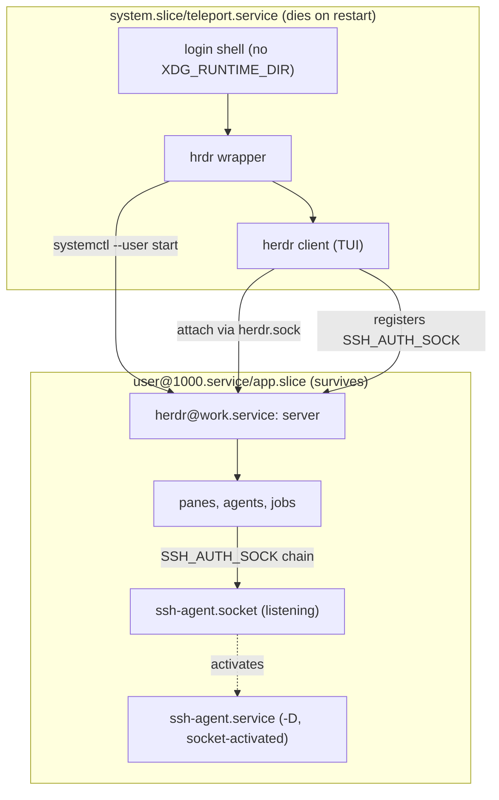
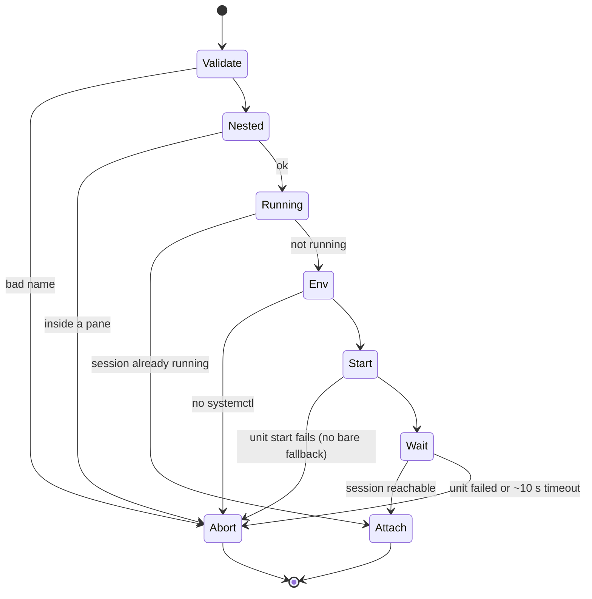
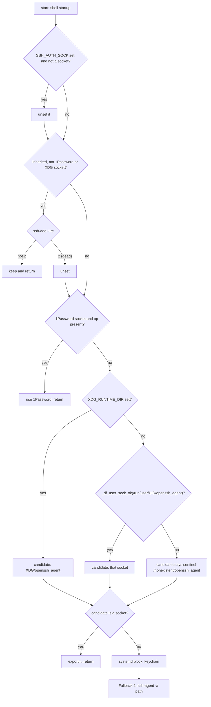

# Surviving a Teleport restart: reference specification

This document specifies a solution precisely enough to rebuild it. It is a companion to the narrative article, `teleport-survival.md`. Placeholders used throughout: host `devbox`, user `dev` (UID 1000), home `/home/dev`, Herdr session `work`. All PIDs and timings are illustrative of measured runs.

**Evidence labels.** *Measured* means observed on the host with a command. *Inferred* means concluded from behaviour or from a binary's strings, not confirmed in source. *Read from source* means read in the upstream source of the named version. A claim carries one of these where it matters.

## 1. Problem statement

AI coding agents (Claude Code, Codex, Grok) run for hours inside panes of a terminal multiplexer on a Linux host that users reach through Teleport. A restart of `teleport.service` killed every pane, and with it every agent and background job, and also the SSH agent the panes used for Git signing and pushes.

### 1.1 Functional requirements

- F1. A Herdr server, and a tmux server, started for agent work remain running when the Teleport service restarts. Panes, agents and jobs inside them stay up.
- F2. After a restart, a new Teleport shell reattaches to the same Herdr session.
- F3. The SSH agent that panes use survives a Teleport restart and keeps its loaded keys.
- F4. Every existing pane and every fresh Teleport shell reach the same agent.
- F5. The cutover should not interrupt running panes. The live cutover did interrupt them briefly (section 6.3, step 4); the procedure restores the path in step 5.

### 1.2 Non-functional requirements

- N1. No process in a pane may inherit a stale session identity (`HERDR_*`, `TELEPORT_*`, `SSH_*` login variables) from whoever started the server.
- N2. `hrdr` and `tm` never silently start a bare Herdr or tmux server outside a unit or scope: they abort instead. For the SSH agent, on a host with the user `ssh-agent.socket` the validated user socket is selected before any agent is started. **This is not absolute for agents:** Fallback 2 in `10-ssh-agent.sh` (a plain `ssh-agent -a <path>`, section 3.4) remains, and it runs in the caller's cgroup, which in a Teleport shell is `teleport.service`, when no earlier choice provides a socket. Making it absolute would mean aborting in that branch instead; that was not done.
- N3. A socket path that another local user could pre-create must never be exported as `SSH_AUTH_SOCK`.
- N4. Tests that source the shell scripts must not be able to reach the operator's live `/run/user/$UID`.
- N5. Changes are limited to the dotfiles source tree and are applied by explicit path.

### 1.3 Non-goals

- Migrating a running bare Herdr server in place. That is a restart and kills its panes; it is a separate, operator-authorised act.
- A key expiry policy. The operator ruled no expiry.
- Surviving a host reboot. Agents and the server stop at reboot; only the unit definition persists.
- Protecting against a hostile process running as the same user (it can already use the agent).
- Protecting tmux sessions started by hand before the wrapper existed.

## 2. Environment model

### 2.1 Cgroups and Teleport

- `teleport.service` is a system service with `KillMode=control-group`. *Measured* on this unit (`systemctl show`): `KillSignal=15`, `TimeoutStopUSec=1min 30s`, `SendSIGKILL=yes`, `FinalKillSignal=9`, `SendSIGHUP=no`. With `KillMode=control-group`, systemd applies the unit's stop signals to every process in the cgroup: SIGTERM first, then SIGKILL to survivors after the stop timeout (systemd.kill(5) defaults, confirmed by these values). *Measured*: the processes in the cgroup died on a restart, including a background driver started with `nohup`, which reported status 144 (128+16, neither 137 nor 143). I could not derive why 144 and do not explain it. Which of the two signals ended each process was not captured; an agent CLI that exits on SIGTERM is still killed mid-run.
- A Teleport login's shell and everything it starts is in `0::/system.slice/teleport.service`. Re-parenting, `nohup` and `disown` do not change cgroup membership. The test is `cat /proc/<pid>/cgroup`, never the parent PID.
- The per-user manager `user@1000.service` has its own cgroup subtree, `user.slice/user-1000.slice/user@1000.service/`. Units run by it live in `.../app.slice/`. A restart of Teleport does not touch it.
- Linger (`loginctl show-user 1000 -p Linger` returned `Linger=yes`, *measured*) keeps `user@1000.service` up with no login session.
- `systemctl show teleport.service -p NRestarts` counts automatic restarts. A manual `systemctl restart` leaves it at 0 (*measured*). Use `ActiveEnterTimestamp` and `MainPID` as evidence that a restart happened.

### 2.2 Environment variables by context (all *measured*)

| Context | `XDG_RUNTIME_DIR` | `DBUS_SESSION_BUS_ADDRESS` | `SSH_AUTH_SOCK` |
|---|---|---|---|
| Teleport shell and the Herdr client it starts | unset | unset | set by shell startup (before the fix: `~/.ssh/ssh-agent-1000.sock`; after: `/run/user/1000/openssh_agent`) |
| Herdr server started by the unit | `/run/user/1000` (set by the unit) | `unix:path=/run/user/1000/bus` (set by the unit) | `/run/user/1000/openssh_agent` (the user manager's own value) |
| A pane shell | `/run/user/1000`, bus address (inherited from the unit) | inherited | `~/.config/herdr/sessions/work/herdr.sock.agent` |
| User manager | n/a | n/a | `/run/user/1000/openssh_agent`, set by `ssh-agent.socket`'s `ExecStartPost` |

Consequence: from a Teleport shell, `systemctl --user` and `systemd-run --user` fail until `XDG_RUNTIME_DIR=/run/user/<uid>` and `DBUS_SESSION_BUS_ADDRESS=unix:path=/run/user/<uid>/bus` are exported. `pam_systemd` does not run for a Teleport login, which is why they are missing (*inferred* from their absence).

`/proc/<pid>/environ` is the environment at `exec`, before any shell startup file exports. A shell's own exported value must be read from its children.

### 2.3 Herdr

- One server process per named session, with its own socket under `~/.config/herdr/sessions/<name>/`. *Measured* directory contents: `herdr.sock` (server), `herdr-client.sock`, `herdr.sock.agent` (a symlink), logs, `session.json`.
- The TUI client (`herdr --session <name>`) attaches to that server. If no server is running, `herdr --session` spawns one in the caller's cgroup (*measured*: the old live server was in `teleport.service`).
- A client's loss on a Teleport restart is harmless; the server and panes are separate processes under the unit.
- `HERDR_SOCKET_PATH` outranks the session name when set (unit comment). `herdr` refuses to nest: `HERDR_PANE_ID` set means inside a pane.
- **SSH-agent registration** (*inferred*): the Herdr binary contains strings for an SSH agent registration/refresh feature (`SSH agent registration`, `SSH agent refresh unavailable; retrying while attached`, `SSH agent must be an absolute, user-owned socket`). *Measured*: the `herdr.sock.agent` symlink was created at the moment the server started, and its target equalled the Teleport-side client's `SSH_AUTH_SOCK`, not the server's (they differed). So the symlink target comes from the attaching client. Whether a later attach by a client with a different `SSH_AUTH_SOCK` re-points an existing symlink was **not measured**; the cutover does not depend on it.

## 3. Components



### 3.1 `herdr@.service` (user unit template)

Installed at `~/.config/systemd/user/herdr@.service`; source `home/dot_config/systemd/user/herdr@.service` in the dotfiles tree. One instance per session; `%i` is the session name.

| Directive | Value | Reason |
|---|---|---|
| `[Unit] Description` | `Herdr server (session %i)` | labelling |
| `Type` | `simple` | the server stays in the foreground; `start` returns at fork, so readiness is checked separately (see 3.2) |
| `ExecStart` | `%h/.local/bin/herdr server` | `%h` is the user's home |
| `Environment=HERDR_SESSION` | `%i` | selects the session; `HERDR_SOCKET_PATH` would outrank it, hence the scrub below |
| `Environment=XDG_RUNTIME_DIR` | `/run/user/%U` | a unit has no login; panes need it for `systemctl --user` |
| `Environment=DBUS_SESSION_BUS_ADDRESS` | `unix:path=/run/user/%U/bus` | same |
| `Environment=PATH` | an explicit list: pinned node bin dir, Go and Cargo bin dirs, `~/.local/bin`, `/usr/local/bin`, `/usr/bin`, `/bin` | a unit sources no shell rc. The node bin is pinned deliberately and must be bumped when the default node moves |
| `SSH_AUTH_SOCK` | not set | inherited from the user manager (its own value); never hard-coded |
| `UnsetEnvironment` (three lines) | `HERDR_SOCKET_PATH HERDR_CLIENT_SOCKET_PATH HERDR_ENV HERDR_PANE_ID HERDR_TAB_ID HERDR_WORKSPACE_ID HERDR_STARTUP_CWD HERDR_BIN_PATH`; `TELEPORT_SESSION` and four related `TELEPORT_*` names; `SSH_TTY SSH_CONNECTION SSH_CLIENT SSH_SESSION_ID` and four more Teleport-related `SSH_*` names | the server and every pane inherit exactly the unit's environment. systemd has no globs, so every known name is listed. This stops a live session's socket or a dead login's identity leaking in |
| `Restart` | `no` | a crash must not silently respawn an empty server; the panes were the state |
| `KillMode` | `control-group` | the unit's stop signals apply to the whole group |
| `[Install]` | none | the unit is `static`: nothing starts it at boot. See section 8 |

The measured cgroup of a pane process under this unit: `.../user@1000.service/app.slice/app-herdr.slice/herdr@work.service`.

### 3.2 `hrdr` (connect flow)

A POSIX `sh` wrapper installed as `~/.local/bin/hrdr` (source `executable_hrdr`). Rules for `hrdr <name>`:

1. Validate the name: non-empty, no leading `-`, no `/` or whitespace.
2. Refuse when nested (`HERDR_PANE_ID` set); herdr cannot nest and named sessions are separate servers.
3. `ensure_server_unit`:
   - **Early return if the session is already running** per `herdr session list --json` (`jq` select on `.running`). Starting `herdr@<name>` on an occupied socket would fail and abort a good reattach. This also covers a bare, pre-unit server.
   - Export `XDG_RUNTIME_DIR=/run/user/<uid>` and the bus address, derived from `id -u`.
   - If `systemctl` is absent: abort.
   - `systemctl --user start herdr@<name>.service` (idempotent). On failure: abort with a message; **never fall back to a plain `herdr --session`**.
   - Poll up to 50 times at 0.2 s (about 10 s) for the session to be reported running (its socket answers; "unit active" is not proof). Each round, if the unit `is-failed`, abort at once. At timeout, abort.
4. Set the terminal title and run `herdr --session <name>`.



`hrdr` also provides `ls`, `stop`, `rm`, `-r <target>` (remote attach) and an interactive picker that only attaches. Out of scope here.

Known gap: `hrdr stop` and `rm` do not scrub `HERDR_SOCKET_PATH`.

### 3.3 `tm` (tmux)

A POSIX `sh` wrapper (source `executable_tm`). tmux's server daemonizes into the cgroup of whoever ran its first command, so `tmux_start` wraps that first command:

- If `tmux -N list-sessions` succeeds, a server exists: run the command as is. (It also trusts that server's cgroup; it does not verify it.)
- Otherwise export the runtime variables from the uid and run `systemd-run --user --scope --quiet --unit=tmux-server-<epoch> -- tmux <args>`.
- If `systemd-run` is absent: abort, never start tmux outside a scope.
- Existence probes that may find no server use `tmux -N` (no server start). *Measured*: against a dead default socket, `tmux list-sessions` and `has-session` returned rc 1, "no server running", and started nothing.
- Uses the default socket and prefixes session names with the output of `whoami` plus `-`. The create path builds a host-specific layout.

### 3.4 SSH agent selection (`10-ssh-agent.sh`)

Installed at `~/.config/bashrc.d/10-ssh-agent.sh`; sourced by interactive bash and zsh. Order, first match wins:

1. Drop an inherited `SSH_AUTH_SOCK` that is not a socket.
2. An inherited socket other than the 1Password or `$XDG_RUNTIME_DIR/openssh_agent` ones is probed with `ssh-add -l` (bounded by `timeout 2` where available). Exit status 2 means "cannot connect": discard it. Any other status keeps it (fail open; 124 and 127 included).
3. The 1Password agent, if its socket and the `op` CLI both exist (desktop only).
4. The systemd user socket, per 3.5.
5. `keychain`, if installed.
6. Fallback 2: a plain `ssh-agent -a <path>` on a predictable path: `$XDG_RUNTIME_DIR/ssh-agent-<uid>.sock` or, without XDG, `~/.ssh/ssh-agent-<uid>.sock`. If that path is already a live socket (`ssh-add -l` not 2) it is reused; if stale (2) it is removed first.

On a host with `ssh-agent.socket`, step 6 should no longer be reached. It is also how an agent lands in `teleport.service`: a shell that gets there starts the agent in its own cgroup. The script never invokes a bare `ssh-add` to load a key; it uses `ssh-add -l` only for socket and liveness checks. A bare `ssh-add` reads the passwd user's key and can block on a passphrase prompt at shell start (*measured* in the script's comments).



### 3.5 The trust predicate `_df_user_sock_ok`

Defined with identical text in `10-ssh-agent.sh` and `shell/env.sh` (a harness assert compares them). POSIX syntax, using only function-local `set --`:

```sh
_df_user_sock_ok() {
    [ -S "$1" ] && [ -O "$1" ] || return 1
    set -- "${1%/*}"
    [ -d "$1" ] && [ -O "$1" ] || return 1
    set -- "$(command ls -ld -- "$1" 2>/dev/null)"
    case ${1%% *} in
    d????-??-?*) return 0 ;;
    esac
    return 1
}
```

Exact checks, in order: the candidate is a socket (`-S`, which follows a symlink) and owned by the effective user (`-O`); its parent directory exists and is owned by the user; and the first field of `ls -ld` on that directory matches the glob.

Mode glob `d????-??-?*`, read as character positions of the mode string: 1 `d`; 2-5 any four (owner `rwx` and group-read); 6 `-` (group-write must be clear); 7-8 any (group-exec, other-read); 9 `-` (other-write must be clear); 10 any; the trailing `*` absorbs an ACL `+` or SELinux `.` suffix. Sticky, setgid and setuid bits sit in positions that the "any" wildcards cover. A symlinked runtime dir presents `l` first and fails closed (a reviewer verified the glob across these cases).

**Sentinel.** The caller's candidate variable starts as `/nonexistent/openssh_agent`. It is reassigned only on a passing predicate. Both later `-S "$SYSTEMD_SOCK"` tests in the script then cannot export a refused candidate, because a refused candidate is never in the variable. (A mutation that assigned the candidate unconditionally exported a group-writable root's socket; the harness case (b) went red.)

**Cost.** One `ls -ld` fork, paid only when the socket exists.

### 3.6 `env.sh` (POSIX variant)

`~/.config/shell/env.sh` is sourced by every shell (including `ssh host cmd` and `zsh -c`), so it must be POSIX, silent and cheap. It carries the same predicate text and this logic:

```sh
if [ -z "${SSH_AUTH_SOCK:-}" ]; then
    if [ -n "${XDG_RUNTIME_DIR:-}" ]; then
        [ -S "$XDG_RUNTIME_DIR/openssh_agent" ] && export SSH_AUTH_SOCK="$XDG_RUNTIME_DIR/openssh_agent"
    else
        _df_sock="${DF_RUN_USER_ROOT:-/run/user}/${UID:-$(id -u)}/openssh_agent"
        _df_user_sock_ok "$_df_sock" && export SSH_AUTH_SOCK="$_df_sock"
        unset _df_sock
    fi
fi
```

(The real file uses `if` blocks; this is the logic.) The fast path (XDG set) forks nothing. `$UID` is a bash/zsh variable; under dash the `id -u` fork happens only in the no-XDG branch. It only fills a gap: an inherited `SSH_AUTH_SOCK` (for example a forwarded agent) is never overwritten.

### 3.7 `DF_RUN_USER_ROOT` test seam

`${DF_RUN_USER_ROOT:-/run/user}` is the root under which the no-XDG candidate is looked up. It exists so tests can point the lookup at a fake tree. It is not a user setting. Anything that sources these files in a test must set it (section 7.3).

### 3.8 User `ssh-agent.socket` and `ssh-agent.service`

```ini
# ssh-agent.socket
[Socket]
SocketMode=0600
ListenStream=%t/openssh_agent
ExecStartPost=/usr/bin/systemctl --user set-environment SSH_AUTH_SOCK=%t/openssh_agent
ExecStopPre=/usr/bin/systemctl --user unset-environment SSH_AUTH_SOCK
[Install]
WantedBy=sockets.target

# ssh-agent.service
[Unit]
ConditionEnvironment=!SSH_AGENT_PID
Requires=ssh-agent.socket
[Service]
Type=simple
ExecStart=/usr/bin/ssh-agent -D
SuccessExitStatus=2
[Install]
Also=ssh-agent.socket
WantedBy=default.target
```

*Measured*: the socket was enabled and active (listening); the service was inactive and `disabled`, `TriggeredBy` the socket, and started on the first connection. *Measured*: a throwaway transient socket plus `ssh-agent -D` on OpenSSH 10.0p2 started lazily, ran in `user@1000.service/app.slice/`, and held a throwaway key. *Read from source* (upstream 10.0p2 `ssh-agent.c`, around lines 2375-2391): with `-D`, no `-a`, no command, and `LISTEN_PID`/`LISTEN_FDS` set, the agent uses fd 3 as its socket.

## 4. Options considered and rejected

| Option | Why rejected |
|---|---|
| `nohup`, `disown`, double-fork | Do not change cgroup membership. `nohup` only ignores SIGHUP (`SendSIGHUP=no` here); the cgroup stop sends SIGTERM and then SIGKILL, which none of these affect |
| `herdr update --handoff` to move the live server | Not an experiment for this change; moving a live server in place is a restart that kills every pane. Left as an operator decision |
| `systemd-run --user --scope` per job | Works, and is kept as a one-off workaround, but needs remembering for every job. The durable fix makes the server a unit |
| `ssh-agent@` template unit, or a `systemd-run` scope started from the shell script, for the agent | A second mechanism beside an enabled `ssh-agent.socket` that already provides what is needed; it would also need its own socket path |
| Tracking the agent by pid or marker file | The old `pgrep` guard showed it: a process existing says nothing about where its socket is. Liveness is probed on the socket with `ssh-add -l` exit status |
| A key TTL (`ssh-add -t`) | Operator ruling: no expiry in the durable agent. The default in the key-loading helper (36000 s, about ten hours) would expire the key while the agent lives, so load with `SSH_KEY_TTL=0` |
| Relying on Herdr to refresh its agent link on reattach | Not measured; the cutover re-points the second hop instead |
| `$TMPDIR` (or `/tmp`) as the no-XDG socket location | A predictable name in a world-writable directory can be pre-created by another user. The old expression did this; a foreign socket placed there was exported (*measured*, per the script's comment) |
| Accepting `/run/user/$UID/openssh_agent` on `-S` alone | Ownership and write-permission of the directory are what make it a trust root; see section 5 |

## 5. Security and trust model

**Trust root.** `/run/user/$UID` is created by systemd per user, owned by that user, mode 0700 (*measured*: `dev 700`). No other non-root user can create or replace a name inside it. The operator accepted it as the trust root when `XDG_RUNTIME_DIR` is unset.

**What the predicate refuses.** A socket or directory not owned by the effective user; a directory writable by group or other (the property that made `$TMPDIR` exploitable); a non-directory; a candidate that is not a socket; a symlinked runtime directory (fails closed).

**Sentinel.** A refused candidate leaves the sentinel in place so no later branch can accept it.

**TOCTOU analysis** (*analysis, not tested*). The check and the later use (the client connecting) are separated in time. The window can only be exploited by someone who can modify `/run/user/$UID`, which is private to the user and root. A process running as the same user already owns the agent. Root is out of scope. The residual is therefore a same-uid process, which the threat model does not defend against.

**Socket mode.** `SocketMode=0600` on the user socket.

**Key lifetime.** No expiry, by operator ruling: the key is loaded once without `-t`. Trade-off: while linger keeps `user@1000.service` up, the key stays resident until the agent stops or the host reboots, a standing exposure to any same-uid process. *Read from source (upstream OpenSSH 10.0p2):* `ssh-add -t 0` sends no lifetime constraint, so that key does not expire from the agent's lifetime mechanism: `ssh-add.c:96-97` defaults the lifetime to 0 meaning "forever"; `authfd.c:516-519` emits the lifetime constraint only when `life != 0`; and `ssh-agent.c:1064-1065` skips an identity whose death time is 0 when expiring keys. The key-loading helper's `SSH_KEY_TTL=0` passes that value through (`ssh-add -t "$TTL"`). Separately, *measured*: a key added with `-t 0` to a throwaway agent was still listed after 2 s; that observation is not the evidence for the source claim.

**Environment scrub.** The unit scrubs login-identity variables (N1) so panes cannot act on a dead Teleport session or a stale Herdr socket.

## 6. Operations

### 6.1 Install

1. Apply by **specific path**, never bare. A bare `chezmoi apply` would touch every drifted managed path (156 here, unrelated). For the agent change: `chezmoi apply ~/.config/bashrc.d/10-ssh-agent.sh ~/.config/shell/env.sh`. For the unit and wrappers: apply `~/.config/systemd/user/herdr@.service`, `~/.local/bin/hrdr`, `~/.local/bin/tm`.
2. With the two runtime variables exported, `systemctl --user daemon-reload`.
3. Confirm `Linger=yes` for the user, else `loginctl enable-linger`.
4. Verify installed equals source: `cmp` each installed file against the source file, and `chezmoi diff <paths>` empty.

A chezmoi apply takes the source file's on-disk mode (one file came out 0664, group-writable, in this run); check modes if that matters.

### 6.2 Starting a session

`hrdr work` (starts `herdr@work.service` if needed, waits, attaches). Verify: `cat /proc/$(systemctl --user show herdr@work -p MainPID --value)/cgroup` shows `...user@1000.service/app.slice/app-herdr.slice/herdr@work.service`.

### 6.3 Agent cutover (brief interruption possible)

For a host that already has a Teleport-cgroup agent at `~/.ssh/ssh-agent-1000.sock` and panes pointing at it:

1. Load the key into the user agent: `SSH_AUTH_SOCK=/run/user/1000/openssh_agent ssh-add ~/.ssh/id_ed25519` (no `-t`). Check `ssh-add -l`.
2. Re-point the path atomically (this step has no gap): `ln -sfn /run/user/1000/openssh_agent ~/.ssh/ssh-agent-1000.sock`. GNU `ln` builds a temporary symlink and renames it over the socket; a reviewer saw `IN_MOVED_FROM`/`IN_MOVED_TO` and no `IN_DELETE` on a throwaway path, so there is no moment without a path. Existing panes follow at their next command because `ssh`/`git` connect fresh each time.
3. Confirm from a pane: `readlink -f "$SSH_AUTH_SOCK"` gives `/run/user/1000/openssh_agent` and `ssh-add -l` lists the key.
4. Kill the old agent: after confirming the PID is `ssh-agent -a <path>` in `teleport.service`. **Panes may briefly lose the agent here**, because the old agent's exit can delete the link (step 5).
5. **Re-link; this restores the path.** The old agent's exit removes the path it bound. *Inferred* during the cutover, then *read from source*: upstream OpenSSH 10.0p2 `ssh-agent.c`, `cleanup_socket()` calls `unlink(socket_name)` (around line 2166); `unlink` on a symlink removes the symlink, not its target. In the live run this deleted the new symlink and the panes lost the agent until step 2 was repeated. Run `ln -sfn ...` again.
6. A fresh shell with no XDG and no inherited socket should select the user socket: `env -u XDG_RUNTIME_DIR -u SSH_AUTH_SOCK bash -ic 'echo $SSH_AUTH_SOCK; ssh-add -l'`.

An agent started with a socket-activation file descriptor never sets `socket_name` (*read from source*; not exercised), so it should not remove the path on exit.

**Rollback.** Be precise about what each action does:

- *Removing the symlink* (`rm ~/.ssh/ssh-agent-1000.sock`) does **not** bring Fallback 2 back. A fresh shell still selects the **user** agent (the XDG branch, or the validated `/run/user/<uid>` candidate, comes before Fallback 2). What breaks is the panes' chain: `herdr.sock.agent` points at the removed path, so existing panes have no agent until the link is restored (`ln -sfn /run/user/1000/openssh_agent ~/.ssh/ssh-agent-1000.sock`).
- *Returning to a per-home agent* (the pre-fix behaviour) means making the user socket unavailable first, then letting a fresh shell create the agent:
  1. In this order: `systemctl --user disable --now ssh-agent.socket`, then `systemctl --user stop ssh-agent.service`, then `systemctl --user mask ssh-agent.socket`. Masking is mandatory, not optional: `10-ssh-agent.sh` runs `systemctl --user start ssh-agent.socket` whenever `list-unit-files` still lists the unit, so a socket that is merely disabled is started again by the next shell and Fallback 2 is never reached. This also stops the agent holding the keys. To undo the rollback later, `systemctl --user unmask ssh-agent.socket` and then `systemctl --user enable --now ssh-agent.socket`.
  2. `rm ~/.ssh/ssh-agent-1000.sock` (the symlink).
  3. Start a fresh shell with no inherited `SSH_AUTH_SOCK`. With `/run/user/<uid>/openssh_agent` gone and `keychain` not selecting anything, Fallback 2 runs `ssh-agent -a ~/.ssh/ssh-agent-<uid>.sock` in that shell's cgroup.
  4. Load the key with `ssh-add`.
  5. Verify: `pgrep -a ssh-agent` shows `-a <home>/.ssh/ssh-agent-<uid>.sock`; `cat /proc/<pid>/cgroup` shows the shell's cgroup (in a Teleport shell, `teleport.service`, so this agent will not survive a Teleport restart); `ssh-add -l` lists the key; and from a pane `readlink -f "$SSH_AUTH_SOCK"` resolves to that socket.
  This rollback was **not exercised**; it is derived from the script's selection order. Report before rolling back unless panes have lost the key.

### 6.4 After a host reboot

The unit is `static`: run `hrdr work`. The user agent is a new process: load the key once with `ssh-add`. The agent starts on first connection.

## 7. Verification

### 7.1 Live acceptance after a real restart (the S2 procedure)

Capture a baseline first (service `MainPID`, `ActiveEnterTimestamp`, Herdr `MainPID`, pane count, agent PID and cgroup). Restart `teleport.service`. Then assert, separately:

1. `teleport.service` `ActiveEnterTimestamp` changed (the restart occurred).
2. Herdr server `MainPID` unchanged; pane count unchanged.
3. The agent `MainPID` and cgroup unchanged (`.../app.slice/ssh-agent.service`); it is the only `ssh-agent`.
4. In one existing pane: `readlink -f "$SSH_AUTH_SOCK"` resolves to `/run/user/1000/openssh_agent`; `ssh-add -l` lists the key.
5. In a fresh Teleport shell (no `XDG_RUNTIME_DIR`): its resolved `SSH_AUTH_SOCK` is `/run/user/1000/openssh_agent` and `ssh-add -l` lists the key. Read the value from the shell's children's `/proc/<pid>/environ`, since the shell's own `environ` predates its startup files.
6. Signing works through the agent: `ssh-keygen -Y sign` then `-Y verify`; and authentication to the Git host works.

### 7.2 Measured evidence

| Event | Result |
|---|---|
| Link drop and reattach (day 1) | Panes intact. Service had not restarted (`NRestarts=0`, `ActiveEnterTimestamp` six seconds after boot). Evidence of placement only |
| First real restart | `teleport.service` MainPID 914 to 1486149; Herdr MainPID 1742 unchanged; 43 of 43 panes; the old agent died; a replacement appeared in `teleport.service`, empty |
| Cutover | Live, with the unlink surprise described in 6.3 |
| Second real restart (end state) | service restarted 14:25:17; Herdr MainPID 1742 and 43 panes; agent MainPID 2422221, unchanged, only agent; pane and fresh shell both resolve to the user agent; sign and verify succeeded; Git-host authentication succeeded |

### 7.3 Test harness

A shell test script in the dotfiles repo (`test-update-user-home-dir.sh`) covers the agent selection. Added cases, using a scratch home, a fake runtime root under a short `/tmp` path (unix socket paths are limited to 108 bytes) and an environment with `XDG_RUNTIME_DIR` unset:

- (a) a user-owned 0700 directory holding a socket: `SSH_AUTH_SOCK` is that socket (rc script and `env.sh`).
- (b) a group-writable (0770) and an other-writable (0707) directory: rejected, with a stub `systemctl` that makes the second systemd block run, so a leaked candidate would be exported (rc script and `env.sh`).
- (c) a missing directory: falls through unchanged (no agent spawned).
- (d) `XDG_RUNTIME_DIR` set: behaviour unchanged; the fallback root is ignored.
- the predicate text in both files is identical.
- every clean-environment probe in the harness goes through one helper, `dfenv`; the seam is exported and inside the sandbox.

**Seam enforcement (N4).** `dfenv` runs `env -i` with `DF_RUN_USER_ROOT` set to a fake root under the sandbox, and exits 99 through a guard if that seam is missing or outside the sandbox. A load-time self-test runs a child through `dfenv` and exits 99 if the child does not see the seam. A structural assert fails any raw `env -i` line not marked as the helper. `PROBE_PATH` is prefixed with a `systemctl` stub that always exits 1.

**Mutations run** (each reverted):

- remove the group/other-write check (change the glob to `d*`) in both files: all four case-(b) asserts go red, (a), (c), (d) stay green;
- (reviewer) assign the candidate unconditionally, removing the sentinel: the case-(b) probe exports the unvalidated socket, red;
- make `dfenv` drop the seam: the harness exits 99 at load.

**Honesty note on a test incident.** The first run of the extended harness socket-activated the operator's real user `ssh-agent.service`. The cause was the new default (`/run/user`) being reachable by probes that did not set the seam; the exact trigger was not reproduced. The seam enforcement above is the fix. After it, the agent's `MainPID` was unchanged across a full harness run with `XDG_RUNTIME_DIR` unset.

## 8. Known limitations and open items

- The unit is `static`: nothing starts it at boot; run `hrdr` after a reboot.
- The agent is empty after a reboot; keys must be re-added once per boot.
- The `tm` path (scope-started tmux server) was not exercised live; only `tm ls` with no server was run after the `-N` edits.
- Whether Herdr re-points `herdr.sock.agent` on a later attach was not measured.
- `hrdr`, when it finds the session already running, adopts a bare (non-unit) server silently; a warning when its cgroup is not the unit was proposed, not built.
- `tm` trusts any existing default-socket tmux server's cgroup.
- `hrdr stop` and `rm` do not scrub `HERDR_SOCKET_PATH`.
- The PATH in the unit pins a node version and needs bumping.
- Some of the evidence is single-host and single-operator.

## 9. Glossary

- **cgroup**: a kernel group of processes with shared resource and lifecycle accounting; systemd places each service in one.
- **`KillMode=control-group`**: on stop or restart, systemd applies the unit's stop signals (by default SIGTERM, then SIGKILL after the stop timeout) to every process in the unit's cgroup, regardless of process-tree relationships.
- **user manager (`user@UID.service`)**: the per-user systemd instance, parent of units started with `systemctl --user`.
- **linger**: a setting that keeps the user manager running with no login session.
- **scope**: a transient unit in which a command is run (`systemd-run --user --scope -- <command>`); the processes that command starts are assigned to the scope.
- **static unit**: a unit with no `[Install]` section; it can be started but not enabled.
- **socket activation**: systemd listens on a socket and starts the service on first connection, passing the socket as fd 3 with `LISTEN_FDS`.
- **Herdr session**: a named, persistent server and its panes; each session is its own process with its own socket.
- **`herdr.sock.agent`**: the symlink Herdr maintains per session so panes have a stable `SSH_AUTH_SOCK`.
- **sentinel**: an unreachable path (`/nonexistent/openssh_agent`) kept in a variable so no later branch can accept an unvalidated value.
- **trust root**: the directory whose ownership and permissions justify trusting a name inside it.
- **TOCTOU**: time-of-check to time-of-use, the gap between validating a path and using it.
- **seam**: a deliberate injection point (`DF_RUN_USER_ROOT`) for tests.
