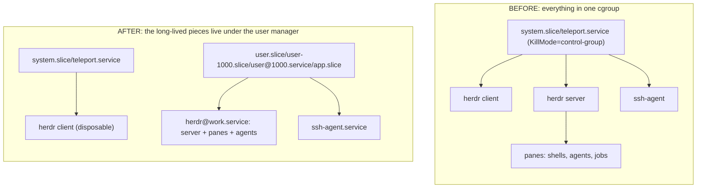
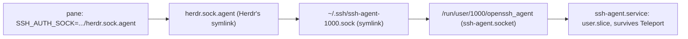
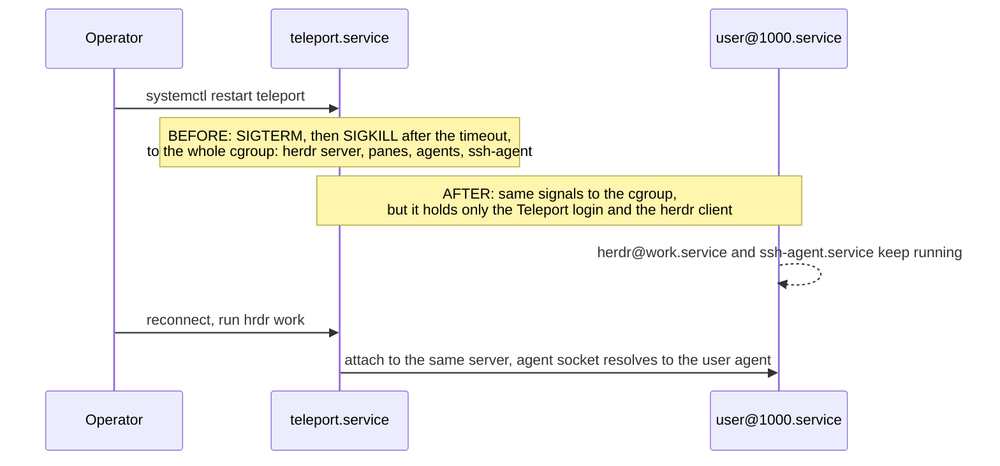

# My AI agents kept dying when Teleport restarted. The fix took two tries.

Long-running AI coding agents (Claude Code, Codex, Grok) are not like the shell sessions we built our tooling around. They run for hours. They hold a task's whole context in a process. When one dies mid-run, you do not lose a prompt; you lose the work and the thread of it.

I run these agents inside a terminal multiplexer on a Linux dev box (`devbox`), reached through Teleport. I use Herdr for most of it and tmux for the rest. For months I assumed that "inside a multiplexer on a server" meant "durable". It does not. One day a Teleport restart took out every pane at once.

This is the story of making them survive, and the part I did not expect: my first "it works" was a test of the wrong thing. It is also a tour of a few Linux mechanics (cgroups, `KillMode`, systemd user units, linger) that are worth knowing precisely, because the shortcuts we all reach for do not do what we think.

## The incident

A long benchmark driver was running in a background shell. I had started it with `nohup`, which is the incantation everyone knows. A Teleport service restart came through and the driver died. Its status came back as exit 144. (144 is 128+16, which is neither the 137 you would expect from SIGKILL nor the 143 from SIGTERM. I could not derive an explanation and I do not offer one; I report what I saw.) Parented by an agent process that was itself a child of the same session, it was gone along with everything else in that Herdr server.

`nohup` makes a process ignore SIGHUP. That is all it does. Nothing here was a SIGHUP.

## Why it happens: a process tree is not what gets killed

Teleport on this box runs as a systemd service, `teleport.service`. Every login it hands out starts inside that service's control group (cgroup). The unit's `KillMode=control-group` means that when systemd stops or restarts the service, it applies the stop signals to every process in the cgroup, not just the main process. I read this unit's real settings: `KillSignal=15` (SIGTERM), `TimeoutStopUSec=1min 30s`, `SendSIGKILL=yes` with `FinalKillSignal=9`, and `SendSIGHUP=no`. So the sequence is SIGTERM to everything in the cgroup, then SIGKILL to whatever is still alive after up to 90 seconds. It does not walk the process tree and does not care who your parent is. An agent CLI that exits cleanly on SIGTERM is still killed mid-run: the work stops all the same. I measured that the processes died; I did not capture which of the two signals ended each one.

That distinction is the whole bug. Four things that feel like protection are not:

- `nohup` makes a process ignore SIGHUP, and this unit has `SendSIGHUP=no`, so it ignores a signal that was never sent; it does nothing about the SIGTERM and SIGKILL that are.
- `disown` removes a job from the shell's table. The process is still in the cgroup.
- Double-forking or re-parenting to PID 1 changes the process tree. The cgroup membership is untouched.
- Starting the multiplexer from your shell puts its server in your shell's cgroup. Herdr's client auto-spawns its server in the caller's cgroup, which from a Teleport login is `system.slice/teleport.service`.

The check that matters is one line:

```sh
cat /proc/<pid>/cgroup
```

If that prints `0::/system.slice/teleport.service`, the process dies with Teleport. The parent PID does not enter into it: a job I started under `systemd-run --user --scope` from a shell still inside `teleport.service` showed a different cgroup in `/proc/<pid>/cgroup`, whatever its parent PID said.



## The fix, part one: give the server a home that Teleport does not own

systemd runs a per-user manager, `user@1000.service`, and anything started under it lives in `user.slice/user-1000.slice/user@1000.service/`. Teleport does not own that cgroup, so restarting Teleport does not touch it. Two pieces make this usable:

1. **Linger.** `loginctl show-user 1000 -p Linger` returned `Linger=yes`, so the user manager stays up with no one logged in. (If it said `no`, I would have needed `loginctl enable-linger`.)
2. **A bus the shell can find.** `systemctl --user` needs `XDG_RUNTIME_DIR=/run/user/1000` and `DBUS_SESSION_BUS_ADDRESS=unix:path=/run/user/1000/bus`. A Teleport shell has neither. I measured that the hard way: `systemd-run --user` from such a shell simply fails until you export them.

With that, a one-off job is easy: `systemd-run --user --scope --unit=bench -- ./driver.sh` put the driver in `.../app.slice/bench.scope`, and it survived. But a scope per job is a workaround, and I did not want to remember to wrap everything. The durable fix is to make the server itself a unit.

I wrote a templated user unit, `herdr@.service`, one instance per named session:

```ini
[Service]
Type=simple
ExecStart=%h/.local/bin/herdr server
Environment=HERDR_SESSION=%i
Environment=XDG_RUNTIME_DIR=/run/user/%U
Environment=DBUS_SESSION_BUS_ADDRESS=unix:path=/run/user/%U/bus
UnsetEnvironment=HERDR_SOCKET_PATH HERDR_PANE_ID ...   # and TELEPORT_*, SSH_TTY, SSH_CONNECTION, ...
Restart=no
KillMode=control-group
```

Three design points are worth the space.

**The environment is a contract, not a copy of your login.** A unit sources no shell rc, so I set `XDG_RUNTIME_DIR` and the bus address in it, so every pane inherits them. And I scrub everything that could leak a dead session in: a stale `HERDR_SOCKET_PATH` would outrank the session name and point the new server at an old socket; `TELEPORT_*` and `SSH_CONNECTION` describe a login that no longer exists.

**`Restart=no`.** A crash must not silently respawn an empty server. The panes are the state; a fresh server with no panes would hide that anything was lost.

**No `[Install]` section.** The unit is `static`. After a reboot nothing starts it until I run a command. That was deliberate, and it is a limitation I come back to.

The wrapper I type, a small script called `hrdr`, does the rest. It starts `herdr@<name>.service`, waits until the server's socket actually answers (a unit being `active` does not prove that), then attaches. Two rules are the point:

- If the unit will not start, it aborts. It never falls back to a plain `herdr --session`, because that would quietly rebuild the exact failure.
- If the session is already running, it just attaches. Starting the unit on an occupied socket would fail, and a fail-fast would then abort a perfectly good reattach.

tmux got the same treatment in a lighter form: the wrapper starts the first tmux command inside `systemd-run --user --scope`, because tmux's server daemonizes into whoever ran the first command.

## The trap: a dropped link is not a restart

By now I had the unit installed, the server in the right cgroup, and about 560 tasks sitting under it. I dropped my Teleport connection and reattached, locally and remotely. Everything was there. I wrote it down as proven.

It was not. I checked the service afterwards:

```text
NRestarts=0
ActiveEnterTimestamp=...13:56:42
```

`teleport.service` had not restarted since boot. I had tested what happens when a client disconnects, not what happens when systemd restarts the service and sweeps its cgroup. Those are different events. The placement predicts survival; it had not observed it.

Two details worth carrying away. First, `NRestarts` counts automatic restarts, so a manual `systemctl restart` leaves it at 0; the timestamp is the honest evidence. Second, the right wording of the claim at that stage was narrow: "the server and panes survived killing a throwaway client and reattaching from a fresh shell". Nothing more.

The next day the operator ran a real `sudo systemctl restart teleport` with a baseline captured first. The result:

- `teleport.service` MainPID changed (914 to 1486149), and `ActiveEnterTimestamp` moved from the previous day to 07:39:40.
- The Herdr server's MainPID was unchanged (1742), and all 43 panes were still there.

That part worked. The restart also exposed what I had not seen at all.

## The second failure: the key agent was in the wrong cgroup

My panes use SSH for Git signing and pushes. After the restart, they could not sign. The ssh-agent my panes talked to was a child of the login shell, so it was in `teleport.service` too, and it had been killed. The reconnect spawned a new one, again inside `teleport.service`, with no keys.

Tracing the chain was the interesting part. A pane's `SSH_AUTH_SOCK` was a path under Herdr's session directory, a symlink Herdr maintains (`herdr.sock.agent`), pointing at `~/.ssh/ssh-agent-1000.sock`, which was the agent in Teleport's cgroup. I measured that the symlink's target matched the Teleport-side client's `SSH_AUTH_SOCK`, not the server's, so Herdr seems to take it from the attaching client. That is an inference from the binary's strings and the timestamps; I did not read Herdr's source.

Meanwhile a perfectly good agent was already there. The user manager had `ssh-agent.socket` enabled and listening at `/run/user/1000/openssh_agent`. Nothing ever connected to it.

Why not? My shell startup file looks for that socket at `$XDG_RUNTIME_DIR/openssh_agent`, and a Teleport shell has no `XDG_RUNTIME_DIR`: `pam_systemd` never ran for it. The script fell through to its last resort, which starts `ssh-agent -a ~/.ssh/ssh-agent-1000.sock` in the calling shell's cgroup.

The fix is to look in `/run/user/$UID` when the variable is missing. But that is the exact shape of a classic bug, and the file even had a comment about it: a fallback to `$TMPDIR` would let another local user pre-create a socket with a predictable name in a world-writable directory. So the fallback sits behind a predicate that accepts a candidate only if the directory is mine and not group- or other-writable, and the socket is mine and really a socket. If the check fails, a sentinel path stays in place so that no later branch can accept it. The old last-resort branch, which starts a plain agent in whatever cgroup the shell is in, is still in the script for hosts with no user socket. On such a host it would still put the agent in Teleport's cgroup.

`/run/user/$UID` is a reasonable trust root: systemd creates it per user, mode 0700, owned by that user. A review pass tried to break the predicate with a mutation that dropped the write check; the tests that cover it went red as they should.



## The cutover, and the surprise

The panes only ever use the second hop. So rather than wait for a natural reattach, I could repoint it:

1. Load the key into the user agent (no expiry; the operator's call).
2. `ln -sfn /run/user/1000/openssh_agent ~/.ssh/ssh-agent-1000.sock`. GNU `ln` creates a temporary symlink and renames it over the socket, so this step has no moment with no path. (The whole procedure was not interruption-free, as step 3 shows.) A reviewer confirmed that with inotify on a throwaway path.
3. Kill the old agent.

Step 3 deleted my new symlink. The old agent had bound `~/.ssh/ssh-agent-1000.sock`; at exit it unlinks the path it bound, and by then that path was a symlink. Every pane lost its agent, briefly. I re-ran step 2, which fixed it. I had inferred the cause at the time, and have since read the upstream OpenSSH 10.0p2 source. `cleanup_socket()` in `ssh-agent.c` does `unlink(socket_name)`, and `unlink` removes a symlink itself rather than its target. Reading the same file, a socket-activated agent (`-D` with `LISTEN_FDS`) never sets `socket_name`, so it should not do this; I have not exercised that path. The order I should have used is: repoint, kill the old agent, then re-link.

## Proof

I did not call it done until a second real restart, run against the end state. Same method: baseline first, then restart.

| Check | Before (1st restart) | After the fix (2nd restart) |
|---|---|---|
| `teleport.service` restarted | yes | yes (14:25:17) |
| Herdr server PID | unchanged | unchanged |
| Panes alive | 43 of 43 | 43 of 43 |
| Key agent | killed; replacement empty, back in `teleport.service` | PID unchanged, `user@1000.service/app.slice/ssh-agent.service`, only agent |
| Key listed from an existing pane | no | yes |
| Fresh Teleport shell reaches the user agent | n/a | yes (its children carried `SSH_AUTH_SOCK=/run/user/1000/openssh_agent`) |
| Signing through the agent | n/a | sign and verify succeeded |

A small trap in that evidence: `/proc/<pid>/environ` shows a process's environment at `exec`, before your shell's startup files export anything. The fresh shell's own value had to be read from its children.



## Lessons

**Measure the condition you claim.** "Survives a link drop" and "survives a service restart" are different claims. I called the first one proof. Write the claim at the strength of the test.

**A reporter is not a gate.** `NRestarts=0` looked like a status; it was a counter that a manual restart leaves untouched. Know what each instrument counts.

**Cgroup, not ppid.** `/proc/<pid>/cgroup` answers "what dies with what". The process tree does not.

**`/proc/<pid>/environ` is the environment at exec**, not now.

**Your tests can touch production.** My first run of the shell-script test harness socket-activated the real user ssh-agent. I had just added a default that looks at `/run/user/$UID`, and probes that did not override it reached the live socket. I never reproduced the exact trigger, but the exposure was real. The harness now runs every probe through one helper that forces a clean environment and a fake runtime-dir root, refuses to run if that seam is missing, and has a guard that fails any raw probe added later.

**Scope your blast radius.** A bare `chezmoi apply` would have touched 156 unrelated managed paths. I applied the two files I meant to change, by name.

**Know your limits.** The unit is `static`, so after a reboot I run `hrdr` once and load the key once. The tmux path is written and probed but I have not exercised it live. I did not measure whether Herdr re-points its agent link on a later attach; the cutover does not depend on it.

## A note on how this was built

The work was done by a small chaired team of AI agents: one planner, adversarial reviewers from different models, and a human operator who approved every live step. The reviews found real defects (an unvalidated socket reachable through a second branch; a test seam that could be forgotten), and the operator's gate on live steps is why a surprising symlink deletion cost a minute and not a morning. That is a story for another post.

## Further reading

The reference document, `teleport-survival-reference.md`, specifies every component, the trust model, the options I rejected, the procedures, and the test cases, in enough detail to rebuild the solution. 

*Diagrams: Medium and LinkedIn do not render Mermaid. Export each block to PNG or SVG first, for example with `mmdc -i diagram.mmd -o diagram.svg`.*
